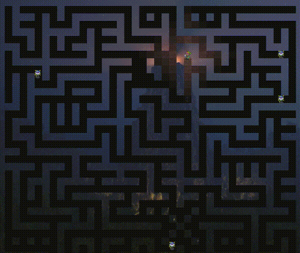

# Visualiseur de Labyrinthe JavaFX

[English Version](README.md)



Un "dungeon crawler" en 2D réalisé avec JavaFX, incluant le chargement d'étages, des animations fluides et un éclairage dynamique. Ce projet a été développé dans le cadre d'un projet académique d'ingénierie logicielle (SAÉ S3.5).

## Fonctionnalités

- **Exploration Multi-Niveaux** : Naviguez entre les différents étages via des escaliers.
- **Gameplay Interactif** : Contrôlez le héros (Link) à l'aide des flèches directionnelles.
- **Entités Dynamiques** : Monstres aux déplacements aléatoires avec détection de collisions.
- **Améliorations Visuelles** :
  - **Déplacement Fluide** : Animation pixel par pixel découplée de la logique de jeu.
  - **Éclairage Localisé** : Effet de brouillard de guerre dynamique centré sur le héros.
  - **Chargement Procédural** : Analyseur personnalisé pour les cartes d'étages au format ASCII (`.txt`).

## Architecture Logicielle

Le projet suit une séparation stricte **Modèle-Vue-Contrôleur (MVC)** afin d'isoler la logique de jeu du rendu JavaFX :

- **Modèle (`modele/`)** : Hiérarchie du donjon basée sur une grille (`Labyrinthe` → `Etage` → `Salle`), état des personnages (`IPersonnage`), et IA autonome des monstres.
- **Vue (`vue/`)** : Couche de rendu abstraite (`AVue`) gérant les sprites des tuiles, le découpage de la caméra/brouillard de guerre, et les animations d'interpolation de pixels découplées.
- **Contrôleur (`controleur/`)** : Mappage des événements clavier (`KeyEvent`) et synchronisation de la boucle de jeu (`AnimationTimer`).

## Prérequis

- **Java JDK** : 14 ou supérieur (configuré pour Java 14)
- **Maven** : Pour la gestion des dépendances et du build
- **JavaFX** : Intégré via Maven (OpenJFX 13)

## Comment Lancer

1. **Cloner le dépôt.**
2. **Se placer à la racine du projet** :
   ```bash
   cd javafx-labyrinth-crawler
   ```
3. **Lancer l'application** :
   ```bash
   mvn clean javafx:run
   ```

## Documentation

Le projet inclut une documentation technique détaillée dans le dossier `livrables` :

- [Rapport de Projet](livrables/rapport-LableigneThomas.md) : Journal de bord détaillé et détails d'implémentation.
- [Spécifications UML](livrables/diagramme-ThomasLABLEIGNE.pdf) : Vue d'ensemble de l'architecture et diagrammes de classes.
- [Résumé des Objectifs](livrables/README.md) : Liste des objectifs atteints durant le projet.

---
**Développeur :** Thomas LABLEIGNE
