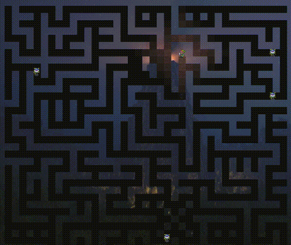

# JavaFX Labyrinth Crawler

[Version Française](README.fr.md)



A 2D dungeon crawler built with JavaFX, featuring procedural floor loading, smooth animations, and dynamic lighting. This project was developed as part of an academic software engineering project (SAÉ S3.5).

## Features

- **Multi-Floor Exploration**: Navigate through different levels using stairs.
- **Interactive Gameplay**: Control the hero (Link) using keyboard arrows.
- **Dynamic Entities**: Randomly moving monsters with collision detection.
- **Visual Enhancements**:
  - **Smooth Movement**: Pixel-by-pixel animation decoupled from logic.
  - **Localized Lighting**: Dynamic fog-of-war effect centered on the hero.
  - **Procedural Loading**: Custom parser for ASCII-based floor maps (`.txt`).

## Software Architecture

The project follows a strict **Model-View-Controller (MVC)** separation to isolate game logic from JavaFX rendering:

- **Model (`modele/`)**: Grid-based dungeon hierarchy (`Labyrinthe` → `Etage` → `Salle`), character state (`IPersonnage`), and autonomous monster AI.
- **View (`vue/`)**: Abstract rendering layer (`AVue`) handling tile sprites, camera/fog-of-war clipping, and decoupled pixel-interpolation animations.
- **Controller (`controleur/`)**: Keyboard event mapping (`KeyEvent`) and game loop synchronization (`AnimationTimer`).

## Requirements

- **Java JDK**: 14 or higher (configured for Java 14)
- **Maven**: For dependency management and build automation
- **JavaFX**: Integrated via Maven (OpenJFX 13)

## How to Run

1. **Clone the repository.**
2. **Navigate to the project root:**
   ```bash
   cd javafx-labyrinth-crawler
   ```
3. **Run the application:**
   ```bash
   mvn clean javafx:run
   ```

## Documentation

The project includes detailed technical documentation in the `livrables` directory:

- [Project Report (English)](livrables/rapport-LableigneThomas.en.md): Detailed development log and implementation details.
- [UML Specification](livrables/diagramme-ThomasLABLEIGNE.pdf): Architectural overview and class diagrams.
- [Achievement Summary](livrables/README.en.md): List of completed project objectives.

---
**Developer:** Thomas LABLEIGNE
